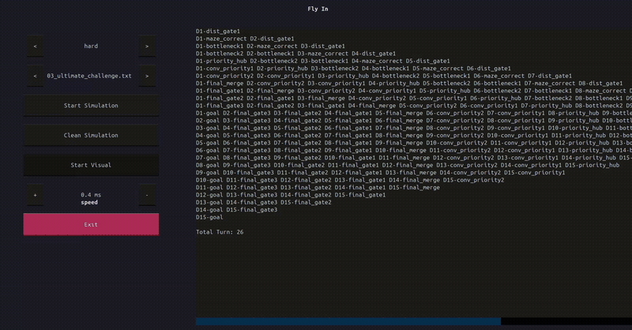

# Description
Fly-in is a project that simulates the movement of drones. Through this project, I learned
how to adapt a graph algorithm to optimize drone pathfinding,
explored different graphical and terminal-based display techniques, and managed
a game loop.

The project allows a lot of freedom, but still comes with a set of requirements:
- Parse map files and convert them into usable data
- Generate a coherent map with its various elements
- Generate a coherent visual representation
- Program using OOP following the given recommendations

The project also includes a bonus objective: complete the provided maps
within a limited number of moves.



# Instructions
In this section, we explain how to install and run the program.

## Installation Instructions

### Make install
The first step is to make sure you are in the root folder of the project. Once there, you can run
the command "make install". This will set up a virtual environment with all the dependencies
installed.

```console
$> make install
```

### Make Lint
Now that the venv is set up, you can run "make lint" to verify the source code. More specifically,
this target will run two linters: Flake8, and Mypy. Flake8 makes sure the code is formatted
properly and has proper syntax, while Mypy is a type checker that verifies the type hints are
consistent.

```console
$> make lint
```
Hopefully no errors occur here as that would mean there are errors in the final version of our
work...

### Make Run
Now for the fun part: launching the program! You just need to run
the command "make run". It will open a menu that lets you test the
different maps.

```console
$> make run
```

### Make Clean
To remove the virtual environment with all its dependencies and cache
files, you can run this command:

```console
$> make clean
```

## Add Map Instruction
If you want to add new maps to the existing ones, go to this subfolder:

```console
data/maps
```

There, you can create a new folder or use an existing one.

Once this is done, you can create your own map by following these rules:
- The file must use the ".txt" format.
- The first line defines the number of drones using nb_drones: <number>.
- Zone definition on each line using type prefixes:
  - start_hub: <name> <x> <y> [metadata] marks the starting zone.
  - end_hub: <name> <x> <y> [metadata] marks the end zone.
  - hub: <name> <x> <y> [metadata] defines a regular zone.
  - The connection syntax forbids dashes in zone names (see below).
- All metadata is optional and enclosed in brackets [...] with default values:
  - zone=<type> (default: normal)
  - color=<value> (default: none)
  - max_drones=<number> (default: 1) - Maximum drones that can occupy this
    zone simultaneously
  - Tags inside brackets can appear in any order.
- Zone types:
  - normal – Standard zone with 1 turn movement cost (default)
  - blocked – Inaccessible zone. Drones must not enter or pass through      this zone.
    Any path using it is invalid.
  - restricted – A sensitive or dangerous zone. Movement to this zone costs 2
    turns.
  - priority – A preferred zone. Movement to this zone costs 1 turn but should
    be prioritized in pathfinding.
- Colors:
    - Colors are optional and can be used for visual representation (terminal output or graphical display).
    - Accepted values for color are any valid single-word strings (e.g., red, blue, gray). There is no fixed list of allowed colors.
  - When colors are specified, the implementation should provide visual feedback through colored terminal output or graphical representation.
- Connections are defined using connection: <name1>-<name2> [metadata]:
  - Define a bidirectional connection (edge) between two zones.
  - The connection syntax forbids dashes in zone names.
  - Optional metadata can be specified in brackets [...]:
    ∗ max_link_capacity=<number> (default: 1) - Maximum drones that can
    traverse this connection simultaneously
- Comments start with ’#’ and are ignored.

# Project Overview

## Project File Organisation
Below is a representation of the file structure, as well as a brief rundown of what each folder contains:

```bash
FLY-IN
│
├── src                     # Source code
│   ├── __init__.py
│   └── ...
├── data
│   ├── maps
│   │   ├── easy
│   │   ├── medium
│   │   ├── hard
│   │   ├── challenger
│   │   └── ...             #Your maps
│   └── requirements.txt
├── .flake8
├── .gitignore
├── Makefile
└── README.md               # It's me! 👋
```

### Notes
- src: Folder containing the source code
- data: Folder containing the different maps and dependencies

### Maps Format
The following is an example of a valid configuration map for this project:

```bash
# Examples

# Numbers of drones
nb_drones: 2

# Hub configuration
start_hub: start 0 0 [color=green]
hub: waypoint1 1 0 [color=blue max_drones=10]
hub: waypoint2 2 0 [color=blue zone=restricted]
end_hub: end 3 0 [color=red]

connection: start-waypoint1 [max_link_capacity=10]
connection: waypoint1-waypoint2
connection: waypoint2-end

```

## PathFinder Algorithm

For this project, I first started with a **Dijkstra** algorithm, which I later evolved into
an **A*** algorithm to improve performance on larger maps.

The principle of this algorithm is to compute the shortest path for each drone by analyzing
the different hubs and assigning a **weight** to each one. At each turn, for each drone,
to account for map changes and hub/connection congestion, a path is recalculated to the final
hub through intermediate hubs, and the shortest one is selected. The A* improvement avoids
exploring every possible path thanks to a heuristic calculation.

## Visualizer

For the visualizer, I chose to implement a graphical display using the **pygame** library.

The workflow is quite straightforward: when I launch the visualizer, I create a game loop.
At each turn, it reads the movements of the current turn, computes where each drone should be
drawn to simulate movement, and then applies a rendering function to display every element in
the correct position with the right sprite in the window. The turns repeat: once drones finish
their animations for turn 1, the visualizer loads turn 2, and so on, until there are no more
movements in the list.

## Menu
For the menu, I had time constraints, so I implemented a terminal-based menu instead of doing
it with pygame, which would have taken longer. However, I still wanted a clear and visual menu,
so I chose to use the **Textual** library, which lets me add CSS-style layout and styling in
the terminal.

# Resources
[Djikstra Algorithm](https://www.geeksforgeeks.org/dsa/dijkstras-shortest-path-algorithm-greedy-algo-7/)

[A* Algorithm Wikepedia](https://en.wikipedia.org/wiki/A*_search_algorithm)

[A* Algorithm geeksforgeeks](https://www.geeksforgeeks.org/dsa/a-search-algorithm/)

[Pygame docs](https://www.pygame.org/docs/)

[Textual tutorial](https://textual.textualize.io/tutorial/)

## AI
For this project, I mainly used AI to help me learn CSS basics, especially with Textual,
which can be a bit different from standard HTML/CSS workflows. I also used it occasionally
to save time while debugging and to better understand some algorithm concepts I had not fully
grasped at first.